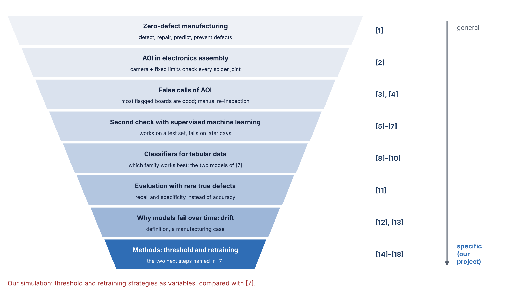
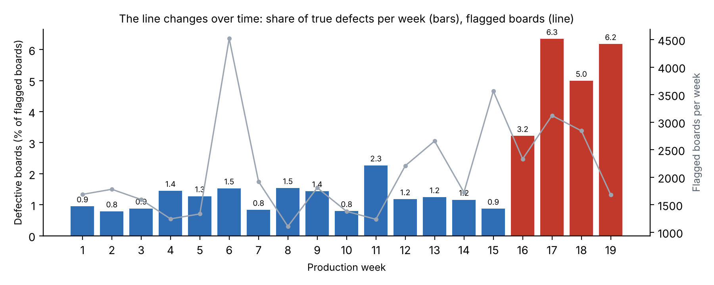

# Binary Classification of AOI Alarms into True Defects and False Calls

**Second check of AOI results with supervised machine learning (Siemens production data)**

[](https://github.com/bodhi584/aoi-false-call-classification/actions/workflows/ci.yml)

Case Study *Intelligent Systems in Production* · Technische Hochschule Deggendorf (THD) · Team 1 · guided by Prof. Dr.-Ing. Hamidreza Heidari
Yu Han (team lead) · Melisa Subasi · Meron Hagos · Alejandro Rivas

## 📥 Download (P2, 3 Nov 2026)

| Document | File |
|---|---|
| **P2 slides** | [`docs/slides_p2.pdf`](docs/slides_p2.pdf) · [PowerPoint with speaker notes](docs/slides_p2.pptx) |
| **Bibliography report** (18 sources) | [`docs/literature_report.pdf`](docs/literature_report.pdf) |
| **Test plan** (design of experiments) | [`docs/test_plan.md`](docs/test_plan.md) |
| **Data understanding** | [`notebooks/data_understanding.ipynb`](notebooks/data_understanding.ipynb) |
| Open-access papers we cite | [`docs/papers/`](docs/papers/) |
| Earlier: P1 proposal and slides | [`docs/proposal.pdf`](docs/proposal.pdf) · [`docs/slides_revised_topic.pdf`](docs/slides_revised_topic.pdf) |

### P2 requirements → where to find them

| Course requirement (P2) | File |
|---|---|
| **Core code** | [`scripts/replicate_pfab2025.py`](scripts/replicate_pfab2025.py) (163 lines): split, models, threshold, retraining |
| **Baseline simulation** | result [`results/replication_pfab2025.json`](results/replication_pfab2025.json) · figure [`docs/img/reproduction_pfab2025.png`](docs/img/reproduction_pfab2025.png) · figure code [`scripts/make_p2_figures.py`](scripts/make_p2_figures.py) · section [5](#5-baseline-our-code-shows-the-same-problem-as-7) below |
| **Test plan** | [`docs/test_plan.md`](docs/test_plan.md) (design of experiments + code tests) |
| **Report** | [`docs/literature_report.pdf`](docs/literature_report.pdf) (bibliography report, 18 sources; LaTeX source in [`docs/literature/`](docs/literature/)) |
| Presentation | [`docs/slides_p2.pdf`](docs/slides_p2.pdf) |
| Unit tests and CI | [`tests/`](tests/) · [CI runs](https://github.com/bodhi584/aoi-false-call-classification/actions/workflows/ci.yml) |

Progress and milestones: [`PROGRESS.md`](PROGRESS.md). Numbers in brackets, such as [7], refer to the bibliography report.

---

## P2 in short

| | |
|---|---|
| **Literature** ([report](docs/literature_report.pdf)) | 18 sources. A machine-learning second check removes false calls on a test set, but on later production days it misses 5–15 % of true defects [7]. |
| **Our question** ([section 2](#2-our-question)) | [7] names two causes, drift and an unstable threshold, and tests neither. Methods for both exist; they become the two variables of our simulation. |
| **Data** ([notebook](notebooks/data_understanding.ipynb), [facts](results/data_facts.json)) | Same public Siemens data as [7]. They change over time: among flagged boards, true defects rose from 1–2 % per week to 3–6 % in the last 4 weeks. |
| **Code** ([core code](scripts/replicate_pfab2025.py)) | We reimplemented the method of [7] with our own code, then corrected the threshold and added retraining. |
| **Baseline** ([result](results/replication_pfab2025.json), [figure](docs/img/reproduction_pfab2025.png)) | Our code shows the same problem as [7]: 1–2 % missed true defects on the test set, 5–14 % on the 5 later periods. |
| **Test plan** ([test plan](docs/test_plan.md)) | Design of experiments: threshold 3 · retraining 6 · retraining data 2 · model 2 → 72 settings × 10 seeds. |
| **Next (P3)** ([progress](PROGRESS.md)) | Run the design of experiments. The simulation software follows in P4–P5. |

## 1. The problem

After soldering, an **automated optical inspection (AOI)** machine measures every solder joint and compares each value with fixed limits. Every flagged board goes to a **manual inspection station**. Most alarms are false: in the Siemens data, about 99 % of the flagged joints and 97.8 % of the flagged boards are **false calls** [4], [7] ([`results/data_facts.json`](results/data_facts.json)). Siemens is working on this today: an AI second check in its Erlangen factory targets 40 % fewer false calls [3].

## 2. Our question



Pfab & Rothering [7] built a second check on the same data. Trained once, it misses about 1 % of true defects on a test set from the same period, but 5–15 % on all five later periods. They name two causes and leave both open:

> “… potential next steps to stabilize the modeling by improving the method for setting the threshold and handling the distribution drifts within the dataset.” ([7], Sec. VII)

| Variable | Option 1 | Option 2 | Option 3 |
|---|---|---|---|
| Threshold | set once, as in [7] | safety margin for 1 % [14] | re-set per period [15] |
| Retraining | never, as in [7] | fixed schedule [12], [17], [18] | when drift is detected [16] |

## 3. Input → system → output

| | |
|---|---|
| **Input** (as in [7]) | Siemens AOI data in time order [4]: one row per flagged solder joint, about 70 AOI measurements, label from the manual station |
| **System** (our code) | [`scripts/replicate_pfab2025.py`](scripts/replicate_pfab2025.py): (1) **reimplemented** the method of [7] (same split, models, logged hyper-parameters, threshold method; their code was read, not copied); (2) **corrected** the threshold: it should come from the best of all training runs; [7] uses the threshold of the last run; (3) **added** retraining before each of the 5 later periods |
| **Output** (as in [7]) | Missed true defects (%) and false calls released (%), per period |

In the end, the system becomes a small web tool for the simulation, with threshold and retraining as settings.

## 4. Data

| | |
|---|---|
| Source | Pfab, Eichler, Mallandur, Rothering (2024), Siemens AG, *Data in Brief* 53, 110110 [4] |
| Content | 440,274 flagged solder joints on 39,742 boards, 132 days, one SMT line |
| Drift | Defective boards 0.8–2.3 % per week, then 3.2–6.3 % in the last 4 weeks; early and late days can be told apart from the measurements alone (AUROC 0.974) |
| Licence | CC BY-NC 3.0, owned by Siemens AG: **not stored here**; [`scripts/download_data.py`](scripts/download_data.py) downloads it and checks the checksum |



## 5. Baseline: our code shows the same problem as [7]

![Baseline: our reimplementation vs. the run logs of [7]](docs/img/reproduction_pfab2025.png)

| Model (10 seeds) | Missed true defects, test set: [7] / ours | Later periods: [7] / ours |
|---|---|---|
| Balanced random forest | 0.7 % / 1.5 % | 7.5 % / 7.5 % |
| Random forest | 0.7 % / 1.9 % | 11.3 % / 9.1 % |

The pattern is the same: low on the test set, several times higher on later periods. The small gaps are checked in P3.

Result file: [`results/replication_pfab2025.json`](results/replication_pfab2025.json), keys `paper_exact_test` and `paper_exact` (the baseline: trained once, threshold logged by [7]) and `paper` (the run logs of [7]). The same file already holds the first runs with the corrected threshold (`test`, `train_once`) and with retraining before each period (`retrain`); they are evaluated in P3.

## 6. Test plan (design of experiments)

| Factor | n | Level 1 | Level 2 | Level 3 | Level 4 | Level 5 | Level 6 |
|---|---|---|---|---|---|---|---|
| A · Threshold | 3 | as in [7], corrected | safety margin [14] | re-set per period [15] | | | |
| B · Retraining | 6 | never, as in [7] | per period | weekly | every 3 days | daily | on drift [16] |
| C · Retraining data | 2 | all data so far | recent window [12] | | | | |
| D · Model | 2 | random forest | balanced random forest | | | | |

**Held constant:** data and split, features, hyper-parameters of [7], recall target 99 %. **Responses:** missed true defects (%) and false calls released (%) per later period, with the reference lines of [7] (≤ 1 %, ≥ 40 %). **Design:** 3 × 6 × 2 × 2 = 72 settings, each with 10 seeds. Details and code tests: [`docs/test_plan.md`](docs/test_plan.md).

## 7. Run it

Windows, macOS or Linux, Python 3.11 or newer, no graphics card.

```bash
git clone https://github.com/bodhi584/aoi-false-call-classification
cd aoi-false-call-classification
pip install -r requirements.txt pytest
python -m pytest -q                          # unit tests (synthetic data)
python scripts/download_data.py              # Siemens data, about 330 MB
python scripts/data_facts.py                 # results/data_facts.json
python scripts/replicate_pfab2025.py runs.csv  # baseline; runs.csv = run log of [7]:
                                             # src/fcr_case_study/notebooks/runs/runs.csv in gitlab.com/research9841542/FCR_1
python scripts/make_p2_figures.py            # P2 figures in docs/img/
```

## 8. Repository

```
scripts/              core code (replicate_pfab2025.py), data download, data facts, figures, classifier screening
notebooks/            data understanding
results/              result files of every number shown here
docs/                 slides, bibliography report, test plan, figures, papers
docs/literature/      LaTeX source of the report and the literature parts
aoi_classification/   P1 package (earlier plan), kept for reference; docs/code_walkthrough.md
model_training.ipynb  P1 notebook, kept for reference
tests/                unit tests, run on every push
```

## References

All 18 sources with summaries: [`docs/literature_report.pdf`](docs/literature_report.pdf). Key ones:

- [4] Pfab, K., Eichler, R., Mallandur, A., Rothering, M. (2024). Data of automated optical inspection of surface-mounted technology electronic production. *Data in Brief* 53, 110110. doi:10.1016/j.dib.2024.110110
- [7] Pfab, K., Rothering, M. (2025). Towards improved research methodologies for industrial AI: a case study of false call reduction. arXiv:2506.14521. Code and run logs: gitlab.com/research9841542/FCR_1

## License

Code: MIT. The Siemens data are not part of this repository and keep their own licence (CC BY-NC 3.0).
