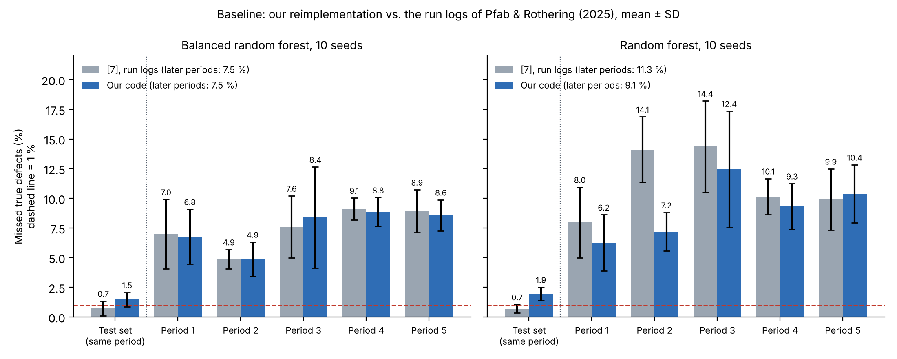

# Binary Classification of AOI Alarms into True Defects and False Calls

Second check of AOI results with supervised machine learning (Siemens production data)
Case Study *Intelligent Systems in Production* · THD · Team 1 · Prof. Dr.-Ing. Hamidreza Heidari
Yu Han · Melisa Subasi · Meron Hagos · Alejandro Rivas

## Read first

| | |
|---|---|
| **Slides (P2)** | [`docs/slides_p2.pdf`](docs/slides_p2.pdf) |
| **Report** | [`docs/literature_report.pdf`](docs/literature_report.pdf) — bibliography report, 18 sources with page references |
| **Test plan** | [`docs/test_plan.md`](docs/test_plan.md) — design of experiments |
| **Core code** | [`scripts/replicate_pfab2025.py`](scripts/replicate_pfab2025.py) — also produces the baseline |
| **Baseline result** | [`results/replication_pfab2025.json`](results/replication_pfab2025.json) · figure below |
| **Data understanding** | [`notebooks/data_understanding.ipynb`](notebooks/data_understanding.ipynb) |

Numbers in brackets, such as [7], refer to the report. [7] = Pfab & Rothering (2025), our core paper.

## The project in one picture

| | |
|---|---|
| **Problem** | About 99 % of AOI alarms are false calls, and people check every one by hand [4], [7]. |
| **Why it matters** | A second check trained once releases 40–78 % of the false calls on later production days, but misses 5–15 % of the true defects instead of at most 1 % ([7], Table IV). |
| **Our question** | Do the two fixes named in [7], a better threshold and retraining, bring the misses back to 1 % while keeping ≥ 40 % of the false calls released? |
| **Input → system → output** | Siemens AOI data in time order [4] → our reimplementation of [7], threshold corrected, retraining added → missed true defects (%) and false calls released (%) per period |

## Baseline: our code shows the same problem as [7]



| Model (10 seeds) | Missed true defects, test set: [7] / ours | Later periods: [7] / ours |
|---|---|---|
| Balanced random forest | 0.7 % / 1.5 % | 7.5 % / 7.5 % |
| Random forest | 0.7 % / 1.9 % | 11.3 % / 9.1 % |

## Test plan (P3)

Threshold 3 levels × retraining 6 × retraining data 2 × model 2 = 72 settings, each with 10 seeds. Details: [`docs/test_plan.md`](docs/test_plan.md).

## Milestones

| P1 · 20 Oct | P2 · 3 Nov | P3 · 24 Nov | P4 · 8 Dec | P5 · 22 Dec | Final · 12 Jan |
|---|---|---|---|---|---|
| proposal ✅ | core code, baseline, test plan, report ✅ | run the DOE; unit tests | full evaluation; simulation tool | packaging, demo video | presentation, report |

## Run

```bash
pip install -r requirements.txt
python scripts/download_data.py                 # Siemens data (CC BY-NC 3.0, not stored here)
python scripts/replicate_pfab2025.py runs.csv   # runs.csv: run log of [7], src/fcr_case_study/notebooks/runs/runs.csv
                                                # in gitlab.com/research9841542/FCR_1
python scripts/make_p2_figures.py               # figures in docs/img/
```

Earlier work (P1 package, drafts, P1 results) is kept on the branch [`archive-p1-p2`](../../tree/archive-p1-p2). Code: MIT licence.
