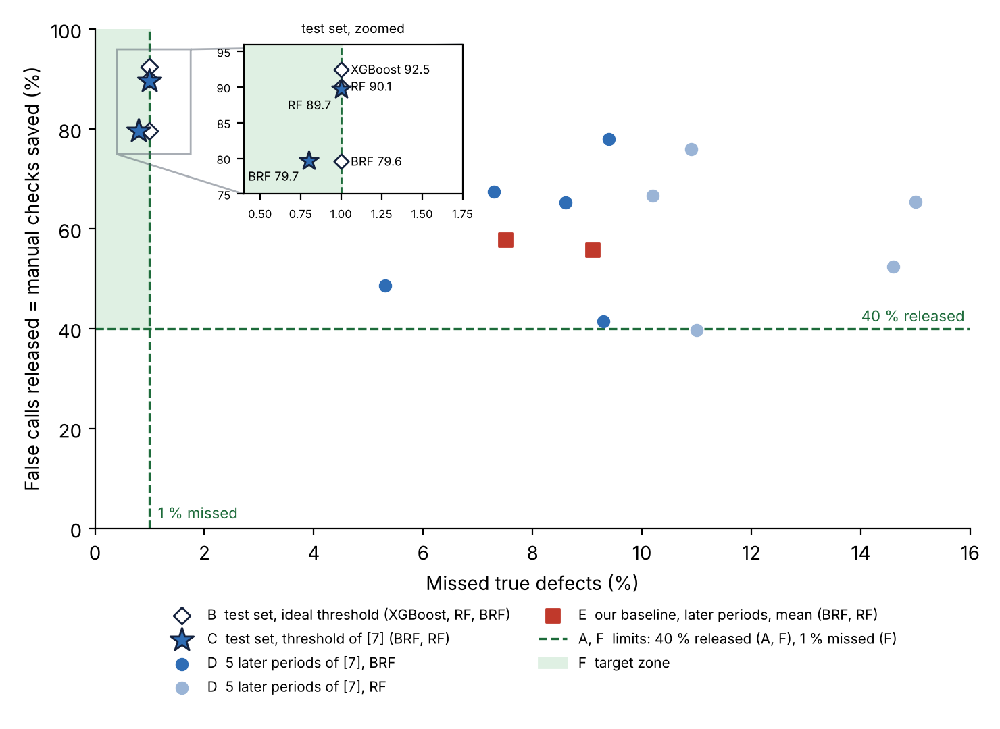
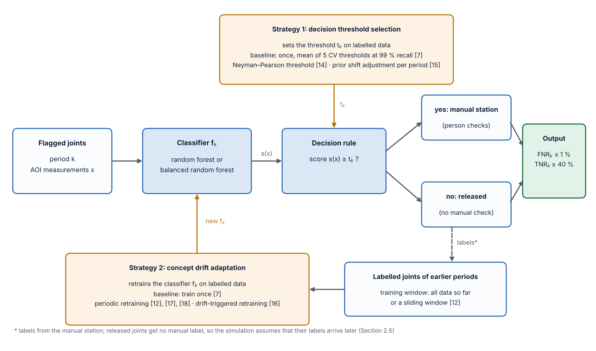

# Binary Classification of AOI Alarms into True Defects and False Calls

Second check of AOI results with supervised machine learning (Siemens production data)
Case Study *Intelligent Systems in Production* · THD · Team 1 · Prof. Dr.-Ing. Hamidreza Heidari
Yu Han · Meron Hagos · Alejandro Rivas

## Results by milestone

| Milestone | Course requirement | Results |
|---|---|---|
| **P1** · 20 Oct (revised 4 Nov) | proposal, tech stack, MVP | [one-page proposal](docs/proposal.pdf) ([Word](docs/proposal.docx)) · [slides](docs/slides_p1.pdf) |
| **P2** · 3 Nov | core code + baseline simulation; test plan + report | [report](docs/literature_report.pdf) · [slides](docs/slides_p2.pdf) · [test plan](docs/test_plan.md) · [core code](scripts/replicate_pfab2025.py) · [baseline result](results/replication_pfab2025.json) · [data understanding](notebooks/data_understanding.ipynb) |
| **P3** · 24 Nov | theoretical framework, methodology, model design | [slides (Google Slides, current version)](https://docs.google.com/presentation/d/1fc6YqLswQVtB1T5kG8M6m11M_FwTKe3LpQccWNHI1P0/edit?usp=sharing) ([PDF](docs/slides_p3.pdf), [PowerPoint with speaker notes](docs/slides_p3.pptx), export of 23 Nov) · [cited papers, cited passages marked](docs/papers) · [figures](docs/img/slides) · data facts: [drift](results/p3_drift.json), [correlation](results/p3_feature_relevance.json) |
| **P4** · 8 Dec | detailed modelling, algorithm development, implementation; experimental design | planned |
| **P5** · 22 Dec | results, evaluation, discussion | planned |
| **Final** · 12 Jan | final presentation and report | planned |

## Project at a glance

- **Project:** We test whether a better decision threshold and retraining keep a machine-learning second check of AOI alarms at or below 1 % missed true defects on later production periods, while it still releases at least 40 % of the false calls.
- **Motivation:** A published second check already saves 40–78 % of the manual checks on later production periods, but it misses 5–15 % of the true defects, so it cannot be used in production.
- **Input:** 440,274 AOI-flagged solder joints from one Siemens line in time order, each with 70 measurements, 5 categories and the label from manual inspection.
- **System:** A balanced random forest classifier with two additions: periodic retraining, so that the model follows the drift of the production data, and a Neyman–Pearson threshold for the 1 % limit.
- **Output:** For every later period, the share of missed true defects (at most 1 %, hard limit) and the share of false calls released (at least 40 %, as high as possible).
- **Factors:** We vary the threshold method, the retraining schedule, the training window and the model; drift, label errors and the random seed act as noise.
- **Limitations:** The results come from one line over 132 days with anonymised data, and released joints receive a label only through a small random audit.

Numbers in brackets refer to the report. [7] = Pfab & Rothering (2025), our core paper.

## The problem



About 99 % of AOI alarms are false calls, and people check every one. A second check with machine learning releases enough false calls on almost all periods (≥ 40 %), but on later production periods it misses 5–15 % of the true defects instead of at most 1 % (D, E). Only the test set from the training period is inside the target zone (B, C).

## Objective

> On every later production period: **missed true defects ≤ 1 %** (hard quality limit) and **false calls released ≥ 40 %**, as many as possible. Expected saving: between 40 % and the 80–90 % reached on the test set. (Report, Section 2.4)

## System



Supervised binary classifier (balanced random forest, as in [7]) with two additions: **periodic retraining** as concept drift adaptation [12] and a **Neyman–Pearson threshold** [14]. The diagram is from the P2 report (Section 2.3); the current system is on slide 10 of the P3 slides.

## Baseline: our code shows the same problem as [7]


| Model (10 seeds) | Missed true defects, test set: [7] / ours | Later periods: [7] / ours |
|---|---|---|
| Balanced random forest | 0.7 % / 1.5 % | 7.5 % / 7.5 % |
| Random forest | 0.7 % / 1.9 % | 11.3 % / 9.1 % |

## P3: design derived from the data and the literature

| Data fact / requirement | Theory | Design choice |
|---|---|---|
| Weak linear relations: highest \|r\| of a measurement with the class is 0.18 | non-linear models [8], [10] | random forest |
| Rare class: 1.05 % true defects | balanced or weighted random forest [10] | balanced random forest |
| Drift over time: true defects per week 0.08–6.65 % | concept drift adaptation [12] | periodic retraining (addition to [7]) |
| Hard limit: missed ≤ 1 % | Neyman–Pearson classification [14] | Neyman–Pearson threshold (addition to [7]) |

Methodology: CRISP-DM. The slides give the reasons, the system, the assumptions and the challenges. The detailed model and the experimental design follow on 8 December, the results on 22 December.

## Test plan (P2)

The test plan of P2 is in [`docs/test_plan.md`](docs/test_plan.md). The experimental design for the design above follows on 8 December.

## Run

```bash
pip install -r requirements.txt
python scripts/download_data.py                 # Siemens data (CC BY-NC 3.0, not stored here)
python scripts/replicate_pfab2025.py runs.csv   # runs.csv: run log of [7], src/fcr_case_study/notebooks/runs/runs.csv
                                                # in gitlab.com/research9841542/FCR_1 (copy it to data/runs.csv)
python scripts/p3_drift_evidence.py             # P3 data facts: drift per week
python scripts/p3_feature_relevance.py          # P3 data facts: correlation with the class
python -m pytest -q                             # unit tests
```

Code: MIT licence.
