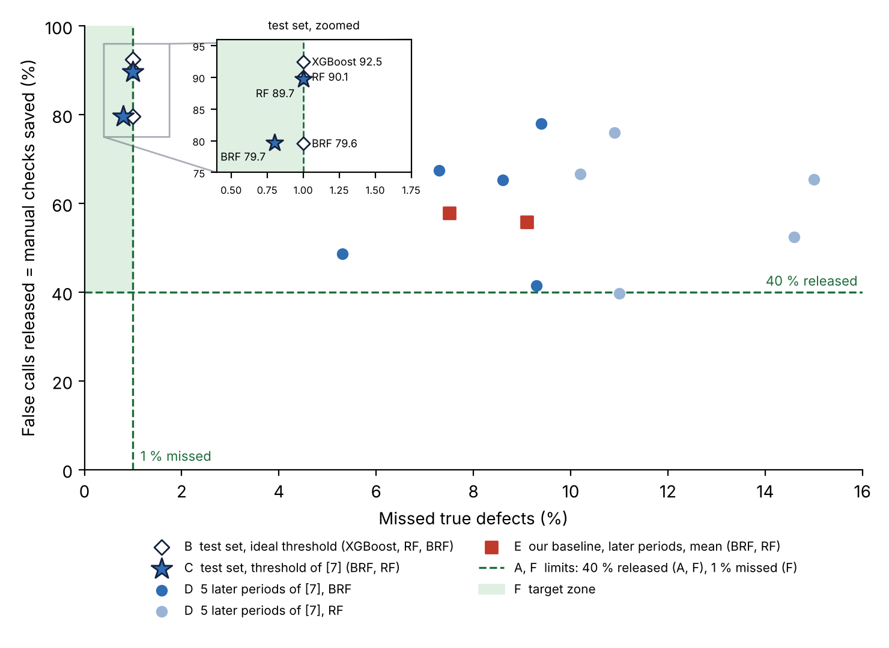
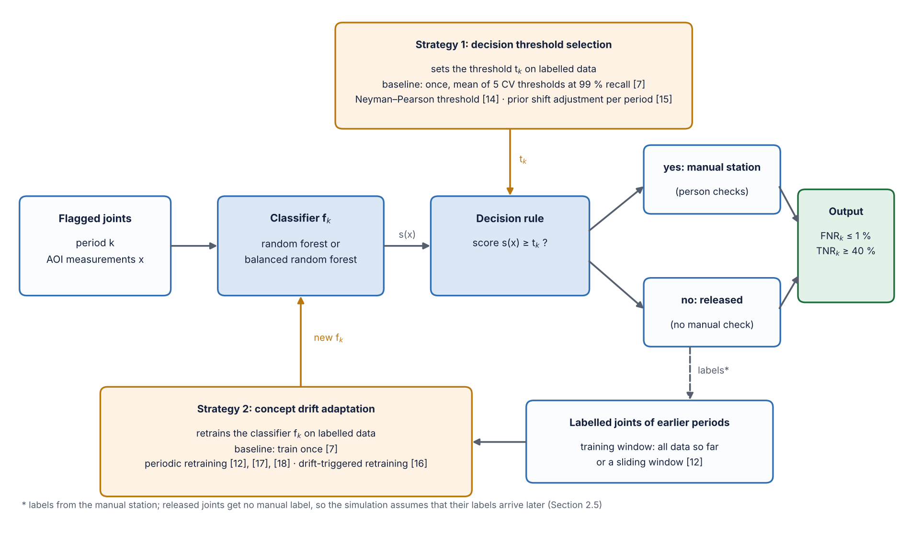

# Binary Classification of AOI Alarms into True Defects and False Calls

Second check of AOI results with supervised machine learning (Siemens production data)
Case Study *Intelligent Systems in Production* · THD · Team 1 · Prof. Dr.-Ing. Hamidreza Heidari
Yu Han · Melisa Subasi · Meron Hagos · Alejandro Rivas

## Results (P2)

| | |
|---|---|
| **Report** | [`docs/literature_report.pdf`](docs/literature_report.pdf) — bibliography report: literature, data, methodology, objective, factors and limitations |
| **Slides** | [`docs/slides_p2.pdf`](docs/slides_p2.pdf) |
| **Test plan** | [`docs/test_plan.md`](docs/test_plan.md) — design of experiments |
| **Core code** | [`scripts/replicate_pfab2025.py`](scripts/replicate_pfab2025.py) — our reimplementation of [7]; also produces the baseline |
| **Baseline result** | [`results/replication_pfab2025.json`](results/replication_pfab2025.json) |
| **Data understanding** | [`notebooks/data_understanding.ipynb`](notebooks/data_understanding.ipynb) |

Numbers in brackets refer to the report. [7] = Pfab & Rothering (2025), our core paper.

## The problem



About 99 % of AOI alarms are false calls, and people check every one. A second check with machine learning releases enough false calls on almost all periods (≥ 40 %), but on later production periods it misses 5–15 % of the true defects instead of at most 1 % (D, E). Only the test set from the training period is inside the target zone (B, C).

## Objective

> On every later production period: **missed true defects ≤ 1 %** (hard quality limit) and **false calls released ≥ 40 %**, as many as possible. Expected saving: between 40 % and the 80–90 % reached on the test set. (Report, Section 2.4)

## System



Supervised binary classifier (random forest, balanced random forest, as in [7]) with two adaptation strategies: **decision threshold selection** (Neyman–Pearson threshold [14], prior shift adjustment [15]) and **concept drift adaptation** by retraining (periodic [12], [17], [18], drift-triggered [16]). (Report, Section 2.3)

## Baseline: our code shows the same problem as [7]


| Model (10 seeds) | Missed true defects, test set: [7] / ours | Later periods: [7] / ours |
|---|---|---|
| Balanced random forest | 0.7 % / 1.5 % | 7.5 % / 7.5 % |
| Random forest | 0.7 % / 1.9 % | 11.3 % / 9.1 % |

## Test plan (P3)

Threshold method 3 × retraining schedule 6 × training window 2 × model 2 = 72 settings, each with 10 seeds. Details: [`docs/test_plan.md`](docs/test_plan.md).

## Run

```bash
pip install -r requirements.txt
python scripts/download_data.py                 # Siemens data (CC BY-NC 3.0, not stored here)
python scripts/replicate_pfab2025.py runs.csv   # runs.csv: run log of [7], src/fcr_case_study/notebooks/runs/runs.csv
                                                # in gitlab.com/research9841542/FCR_1
```

Code: MIT licence.
