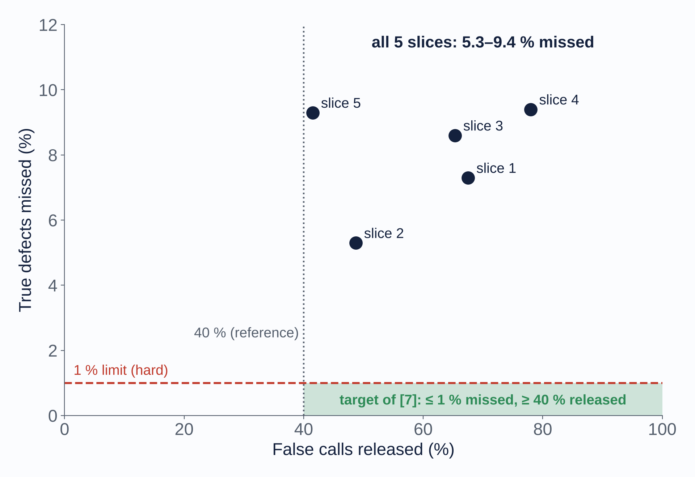
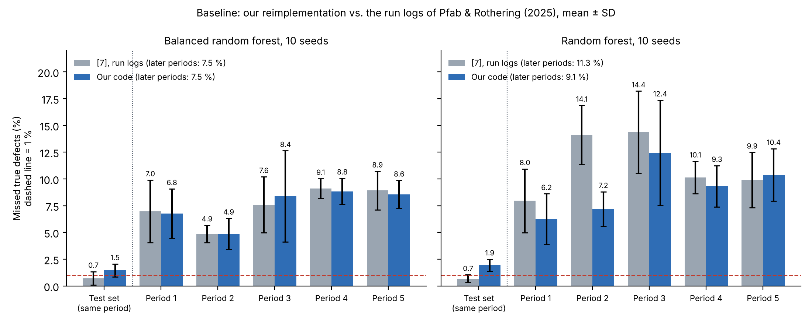

# Binary Classification of AOI Alarms into True Defects and False Calls

Second check of AOI alarms with supervised machine learning (Siemens production data)
Case Study *Intelligent Systems in Production* · THD · Team 1 · Prof. Dr.-Ing. Hamidreza Heidari
Yu Han · Meron Hagos · Alejandro Rivas

## Results by milestone

| Milestone | Course requirement | Results |
|---|---|---|
| **P1** · 20 Oct (revised 4 Nov) | proposal, tech stack, MVP | [one-page proposal](docs/proposal.pdf) ([Word](docs/proposal.docx)) · [slides](docs/slides_p1.pdf) |
| **P2** · 3 Nov | core code + baseline simulation; test plan + report | [report](docs/literature_report.pdf) · [slides](docs/slides_p2.pdf) · [test plan](docs/test_plan.md) · [core code](scripts/replicate_pfab2025.py) · [baseline result](results/replication_pfab2025.json) · [data understanding](notebooks/data_understanding.ipynb) |
| **P3** · 24 Nov | theoretical framework, methodology, model design | [slides (Google Slides, current version)](https://docs.google.com/presentation/d/1fc6YqLswQVtB1T5kG8M6m11M_FwTKe3LpQccWNHI1P0/edit?usp=sharing) ([PDF](docs/slides_p3.pdf), [PowerPoint with speaker notes](docs/slides_p3.pptx), export of 23 Nov) · [cited papers, cited passages marked](docs/papers) · [figures](docs/img/slides) · data facts: [drift](results/p3_drift.json), [correlation](results/p3_feature_relevance.json) |
| **P4** · 8 Dec | detailed modelling, algorithm development, implementation; experimental design | planned |
| **P5** · 22 Dec | results, evaluation, discussion | planned |
| **Final** · 12 Jan | final presentation and report | planned |

## Project at a glance

- **Problem:** The AOI flags solder joints, and a person checks every alarm. About 99 % of the alarms are false calls [4].
- **Goal:** Release as many false calls as possible, and miss at most 1 % of the true defects in every period. A period holds at least 299 true defects, so that 1 % can be measured.
- **Baseline:** The balanced random forest of Pfab & Rothering [7]. On later data it misses 5.3–9.4 % of the true defects [7, Table IV]; our reproduction in P2 shows the same.
- **Input:** 440,274 AOI-flagged solder joints from one Siemens line in time order, each with 75 features (5 categories, 70 measurements) and the label from manual inspection [4].
- **Design (P3):** a balanced random forest with two additions: periodic retraining against the drift of the data, and a Neyman–Pearson threshold for the 1 % limit.
- **Limits:** one production line over 132 days, anonymised data, labels with an unknown error rate; released joints are labelled only through a small random audit.

Numbers in brackets refer to the references of the P3 slides (slide 13); the papers are in [`docs/papers`](docs/papers). [7] = Pfab & Rothering (2025), our baseline.

## The problem



The model of [7] releases enough false calls (≥ 40 %), but on all five later evaluation slices it misses 5.3–9.4 % of the true defects instead of at most 1 % [7, Sect. VI, Table IV].

## Baseline (P2): our code shows the same problem as [7]



| Model (10 seeds) | Missed true defects, test set: [7] / ours | Later periods: [7] / ours |
|---|---|---|
| Balanced random forest | 0.7 % / 1.5 % | 7.5 % / 7.5 % |
| Random forest | 0.7 % / 1.9 % | 11.3 % / 9.1 % |

## P3: theoretical framework, methodology and model design

The six points of the P3 guideline, with the slide that covers each ([slides](docs/slides_p3.pdf)).

**Methodology (slide 3).** CRISP-DM, the standard process model for data mining projects [24]: business understanding, data understanding, data preparation, modeling, evaluation, deployment. P3 covers the first four phases as a design.

**Data and inputs (slide 4).** 440,274 AOI-flagged solder joints from one Siemens line [4]. Input: 75 features (5 categories, 70 measurements). Output: the class, 0 = false call, 1 = true defect, set by a person at the manual station.

**Theoretical framework, algorithms and why they were chosen (slides 5 to 9).** Every choice starts from a fact in the data.

| Data fact / requirement | Theory | Design choice |
|---|---|---|
| Weak linear relations: the highest \|r\| of a measurement with the class is 0.18 | non-linear models [8], [10] | random forest |
| Rare class: 1.05 % true defects | balanced or weighted random forest [10] | balanced random forest |
| Drift over time: true defects per week 0.08–6.65 % | concept drift adaptation [12] | periodic retraining (addition to [7]) |
| Hard limit: missed ≤ 1 % in every period | Neyman–Pearson classification [14] | Neyman–Pearson threshold (addition to [7]) |

**System architecture (slide 10).** Decision path: AOI alarm → input coding → balanced random forest (score) → threshold → release or operator check. Adaptation loop: the operator's labels go into a history; on a fixed schedule the forest is retrained and the threshold is set again. A small random audit gives labels for released joints.

**Assumptions and challenges (slide 11).**

| Design choice | Works only if (assumption) | But in our case (challenge) |
|---|---|---|
| Random forest | the labels are mostly correct, and the features carry non-linear information | the label error rate is unknown and may change over time [4]; non-linear information is not shown yet |
| Balanced random forest | there are enough true defects to learn from | true defects are few: 1.05 %, 18 to 1,283 per week |
| Periodic retraining | the most recent data are the most informative [12]; labels are back before the next retraining | the speed of drift is unknown; drift of p(y\|X) is not shown yet; released joints are labelled by audit only |
| Neyman–Pearson threshold | the true defects are independent and identically distributed [14]; at least 299 of them | the class itself drifts: inspection type 1 is 8.5–78 % of the weekly true defects |

The detailed model and the experimental design follow on 8 December, the results on 22 December.

## Test plan (P2)

The test plan of P2 is in [`docs/test_plan.md`](docs/test_plan.md). The experimental design for the design above follows on 8 December.

## Run

```bash
pip install -r requirements.txt
python scripts/download_data.py                 # Siemens data (CC BY-NC 3.0, not stored here)
python scripts/replicate_pfab2025.py runs.csv   # runs.csv: run log of [7], src/fcr_case_study/notebooks/runs/runs.csv
                                                # in gitlab.com/research9841542/FCR_1 (copy it to data/runs.csv)
python scripts/p3_drift_evidence.py             # P3 data facts: drift per week
python scripts/p3_feature_relevance.py          # P3 data facts: correlation with the class
python -m pytest -q                             # unit tests
```

Code: MIT licence.
