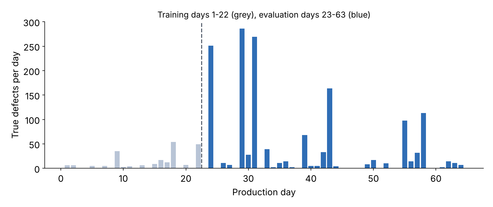
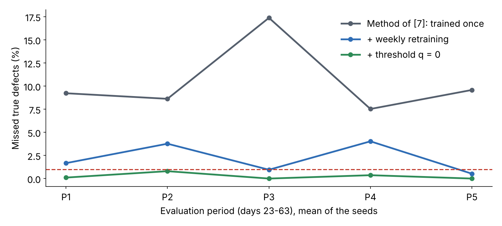
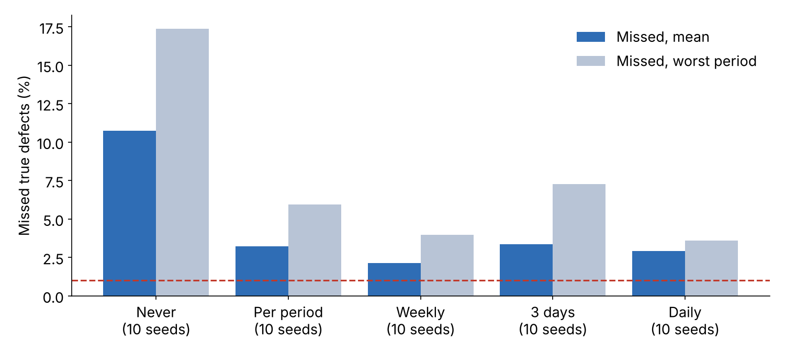
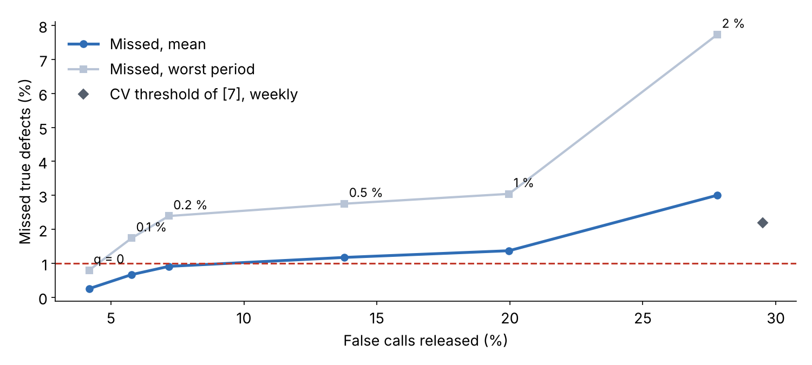

# P3 · Retraining and a new threshold, on the development data

Team 1 · P3, 24 Nov 2026 · [7] = Pfab & Rothering (2025), the core paper. Reference numbers as in the [report](literature_report.pdf); the papers open from [`docs/papers`](papers/README.md).

**Question.** Does the method of [7] improve when we add (1) retraining and (2) a new threshold rule? Measured as in Table IV of [7]: missed true defects and released false calls, period by period, in time order.

**Answer.** Yes. Weekly retraining lowers the missed true defects from 10.7 % to 2.1 %; the new threshold lowers them further, at the cost of release. The target of [7] (≤ 1 % missed in every period, ≥ 40 % released) is not reached yet; that is P4.

## Input



| Part | Rows | Production days | True defects |
|---|---|---|---|
| Development data = first half of the data set [4], as in [7] | 220,137 | 1–63 | 1,749 (0.79 %) |
| · training part | 64,949 | 1–22 | 223 |
| · evaluation part, 5 periods of equal size, in time order | 155,188 | 23–63 | 1,526 |
| Later half | 220,137 | 64–101 | not used; final test in P4 |

The split is in time order: the model only sees the past, as in production. The split at day 22 puts the three days with most true defects (days 24, 29, 31) into the evaluation part.

## System

Balanced random forest (BRF) of [7] with the hyper-parameters [7] logged for its 10 seeds. An alarm is released if its score is below the threshold t.

| | Training | Threshold t | Code (`scripts/`) |
|---|---|---|---|
| Method of [7] | once, on days 1–22 | mean of 5 cross-validation thresholds at 99 % recall | `replicate_pfab2025.py`: `fit()`, `cv_threshold()` |
| **Feature 1:** retraining | again before each interval (per period, weekly, every 3 days, daily) on all rows known so far | as in [7] | `p3_pipeline.py`: `retrain_starts()`, `run()` |
| **Feature 2:** new threshold | weekly | q-quantile of the scores past true defects received from models that had not seen them | `p3_pipeline.py`: `past_threshold()`, `run()` |

## Output



<!-- table -->
| Setting (BRF) | Seeds | Missed, mean | Missed, worst period | Released | Seeds with every period ≤ 1 % |
|---|---|---|---|---|---|
| Method of [7]: trained once, CV threshold | 10 | 10.72 % | 17.38 % | 33.9 % | 0 / 10 |
| Retraining per period | 10 | 3.23 % | 5.93 % | 39.7 % | 0 / 10 |
| Retraining weekly | 10 | 2.12 % | 3.96 % | 29.5 % | 0 / 10 |
| Retraining every 3 days | 10 | 3.36 % | 7.27 % | 37.5 % | 0 / 10 |
| Retraining daily | 10 | 2.92 % | 3.60 % | 46.7 % | 0 / 10 |
| Weekly + threshold q = 0 | 10 | 0.24 % | 0.72 % | 3.9 % | 4 / 10 |
| Weekly + threshold q = 0.1 % | 10 | 0.62 % | 1.74 % | 5.7 % | 0 / 10 |
| Weekly + threshold q = 0.2 % | 10 | 0.90 % | 2.39 % | 7.1 % | 0 / 10 |
| Weekly + threshold q = 0.5 % | 10 | 1.18 % | 2.68 % | 13.7 % | 0 / 10 |
| Weekly + threshold q = 1 % | 10 | 1.42 % | 3.19 % | 19.7 % | 0 / 10 |
| Weekly + threshold q = 2 % | 10 | 3.03 % | 7.78 % | 27.7 % | 0 / 10 |

Source: [`results/p3_results.json`](../results/p3_results.json) (per setting, seed and period), from our [run on Kaggle](https://www.kaggle.com/code/yuhan2026/p3-aoi-false-calls-retraining-and-new-threshold) (Python 3.13, scikit-learn 1.6.1, 4 h 10 min).

 

- **Retraining** cuts the misses from 10.7 % to 2.1 % (weekly) while about 30 % of false calls are still released. Daily retraining releases the most (47 %) at 2.9 % missed. No interval reaches 1 %.
- **The new threshold** at the same 99 % recall level as [7] (q = 1 %, since q is the share of past true defects released) lowers the mean missed share from 2.1 % to 1.4 %, while the release falls from 30 % to 20 %. Smaller q misses less but releases little: q = 0 releases only 3.9 %, close to checking every flag by hand.
- **Remaining misses** lie in periods with few true defects (P2: 138, P4: 303), where 2–5 misses already exceed 1 %. They score below every true defect seen before: defects new to the model.

## Limitations

1. One line; the evaluation part has 41 production days, so 5 periods with 42–852 true defects each.
2. Released joints are assumed to get their label later (needed for retraining).
3. Earlier exploratory runs used days 64–101; they are not used here. Days 64–101 are used once, for the final test in P4, with a system fixed beforehand on days 1–63.

## Next: P4

Analyse the remaining misses; fix q on the development data; test an SPC switch on the line for days like 24, 29, 31; then run the frozen system once on days 64–101.

## Run

On Kaggle: [our run](https://www.kaggle.com/code/yuhan2026/p3-aoi-false-calls-retraining-and-new-threshold) shows every step with its output; to run it again, Copy & Edit, Internet on, Save & Run All (about 3 h). Locally:

```bash
pip install -r requirements.txt
python scripts/download_data.py          # data/dataset.csv; data/runs.csv = run log of [7] (see README)
python scripts/p3_pipeline.py run        # all settings x 10 seeds -> results/p3_results.json
python scripts/p3_pipeline.py report     # table and figures
python scripts/p3_pipeline.py check      # re-runs seed 1 and compares with the stored results
# scikit-learn 1.6.1 as on Kaggle; newer versions compute class_weight="balanced_subsample" differently,
# which changes the 3 seeds that use it (300, 1337, 525600) slightly
python -m pytest -q                      # unit tests, also on every push (CI)
```
