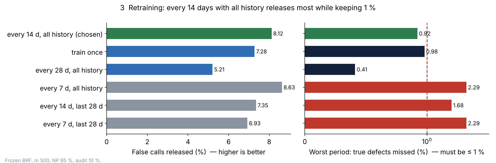
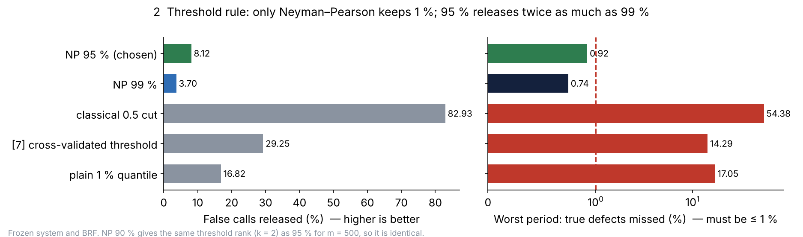
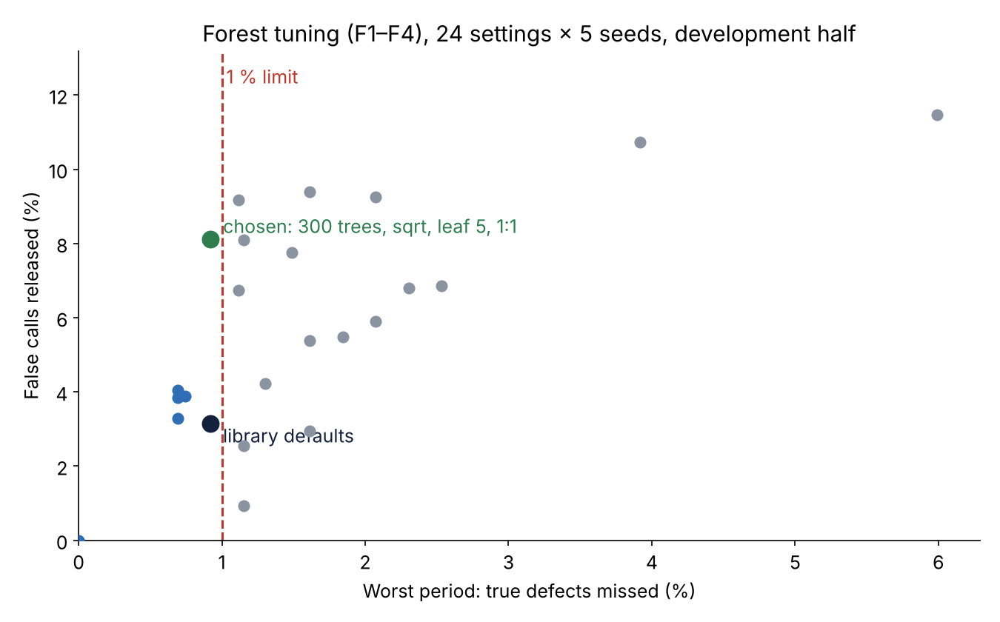
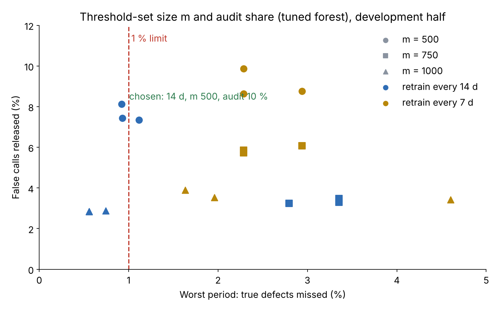
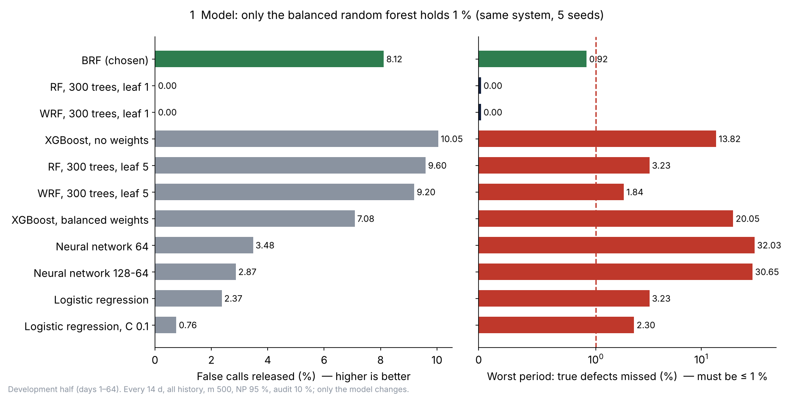
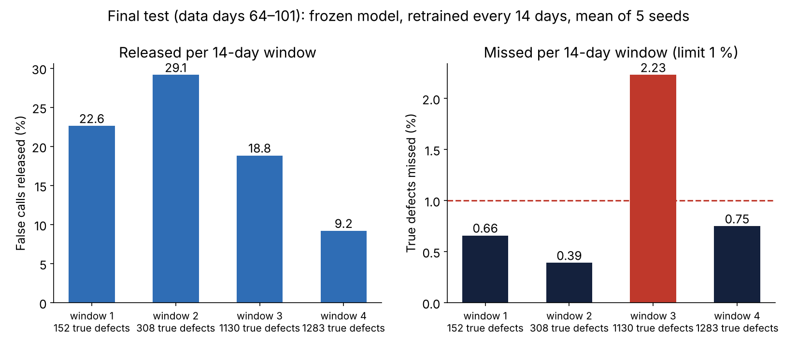
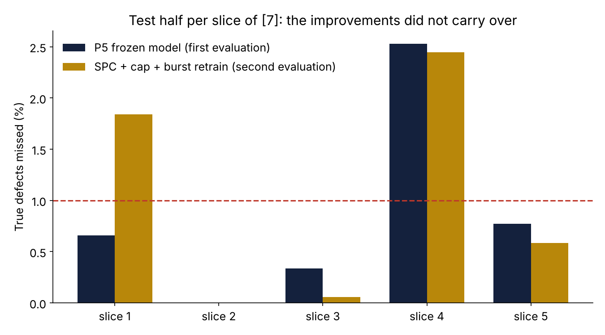

# AOI false-call release: the complete story, results and answers (P4 · P5 · final report)

Team 1 · Intelligent Systems in Production · THD · status 27 Nov 2026

This document is the team's single base for P4 (8 Dec), P5 (22 Dec) and the final report. It tells the story from the requirement to the final test, gives the data behind every decision, and answers the questions we expect. Every number comes from [`docs/results_tables.md`](results_tables.md), which `scripts/make_results_tables.py` generates from the result files in [`results/`](../results). Table IDs in brackets (for example **[P4-4]**) point to that file.

---

## 0. The answer in one page

**What we built.** A second check after the AOI. For each joint that the AOI calls, a balanced random forest (BRF) gives a score. Joints that score below a threshold are released without a manual check; all others go to the operator. The threshold comes from the Neyman–Pearson rule, so that at most 1 % of true defects are released, with 95 % confidence. The model is retrained every 14 days, and a random 10 % of the released joints are audited.

**How we chose it.** We designed, tuned and selected everything on the development half (data days 1–64). The rule was strict: missed ≤ 1 % in **every** period of ≥ 299 true defects and for **every** seed, then the highest released share. Six experiments and 400+ simulated runs chose the frozen model:

| part | chosen | evidence |
|---|---|---|
| S1 retraining | every 14 days | [P4-1], [P4-5], [P4-6] |
| S2 training window | all labelled history | [P4-1], [P4-5] |
| S3 threshold set m | latest 500 true defects (k = 2) | [D3], [P4-1], [P4-6] |
| S4 confidence | 95 % (δ = 5 %) | P3 design |
| S5 audit share | 10 % | [P4-6] |
| F1–F4 forest | 300 trees, max_features sqrt, min leaf 5, 1:1 sampling | [P4-4] |
| model | balanced random forest: the only model of 12 settings (RF, weighted RF, XGBoost, logistic regression, neural network) that holds 1 % | [P4-9] |

**What it achieved on the test half** (data days 64–101, frozen model, run once, 5 seeds) **[P5-1], [P5-2], [C1]:**

| | ours | [7] BRFC2 |
|---|---|---|
| false calls released | **22.7 %** (19.2–25.5) | 41.5–78.0 % per slice |
| true defects missed | **1.29 %** (0.70–1.95) | 5.3–9.4 % per slice |
| recall | 0.987 | — |
| slices with missed ≤ 1 % | 4 of 5 (slice 4: 2.53 %) | 0 of 5 |

That is about **1,300 false calls fewer to check per production day** and about **one missed true defect per production day** [C1]. Our system misses **4–14× fewer** true defects than [7] in every slice. In exchange it releases one third to one half as much.

**Where it fails, and why.** All misses above the limit fall on days of defect **bursts**, for example calendar day 119 with 696 true defects [B1], [B2]. The Neyman–Pearson guarantee assumes that the true defects are i.i.d. A burst breaks this.

**What we tried afterwards.** On the development half only, we added a burst-triggered extra retraining (Yu Han's idea), an SPC switch on the AOI call volume, and a cap on threshold-set defects per day. On the development half these reached 0 % missed and 9.7 % released [P6-1]. A second, openly declared evaluation on the test half gave 1.20 % missed and 23.1 % released [P6E-1], so practically no change. The large test bursts came without unusual call volume, so the SPC switch could not see them [B1].

![Final test vs [7]](img/p5/final_test_vs_ref7.png)

---

## 1. Problem and requirement

- **Process.** After reflow soldering, the AOI flags joints. Most flagged joints are **false calls**: in our data only 1.05 % of the flagged joints are true defects [D1]. An operator checks every flagged joint by hand.
- **Goal.** Release as many false calls as possible without a manual check, while releasing **at most 1 % of the true defects**.
  - The 1 % limit comes from [7] (p. 4, Sect. IV, "realistic requirements from the industrial shopfloor").
  - [7] also names a 40 % release target. We treat 1 % as the hard limit and 40 % as a reference.
- **Baseline.** Pfab & Rothering [7], same Siemens data, same split (first half of the rows / second half), five chronological test slices.
  - Their best balanced random forest (BRFC2) releases 41.5–78.0 % of the false calls and misses 5.3–9.4 % of the true defects in the slices [P5-2].
  - [7] never meets its own 1 % limit on the slices.

**Metrics.**
- **Missed %** = released true defects / true defects (= 1 − recall).
- **Released %** = released false calls / false calls.
- A **period** = consecutive data with at least 299 true defects. With 299 true defects and no miss, the miss rate is ≤ 1 % with 95 % confidence (0.99^299 = 4.95 %). So 299 is the smallest sample in which 1 % can be checked at all.

---

## 2. Data and split

**Data facts [D1].**
- 440,274 flagged joints, 39,742 boards, 101 days with data, 4,622 true defects (1.05 %).
- 70 measurements and 5 categorical features. One-hot coding gives 206 inputs.
- 0 missing values; 6 constant measurements, kept and harmless for trees; 8,752 duplicate rows, kept because they are real repeated calls.
- 7 component codes (meta_feat1) appear only in the test half.
- **Drift:** a classifier separates the first from the last 30 % of the days with AUROC 0.974.

**Split [D2].**

| part | rows | data days | true defects | use |
|---|---|---|---|---|
| development | 220,137 | 1–64 | 1,749 | all design, tuning, selection |
| test | 220,137 | 64–101 | 2,873 | P5 final test (once), P6 second evaluation (once) |

- **Why this split.** It is the split of [7], so our results compare one-to-one with theirs.
- **Day 64 is cut in the middle**, because the split is by rows. In the test, every development row counts as labelled history; the first test row is the first row the system decides on.
- **Inside the development half**, the simulation starts at calendar day 40 (T0). That is the first day with at least 2 × 299 labelled true defects before it, enough for a threshold set and a training set.
- **No information from the test half was used for any choice in P4.** The P6 improvements were also developed on the development half only, but after the P5 result was known. So their test run is reported as a **second evaluation**, not as the final result.

---

## 3. The system (from P3, unchanged)

**Decision path.**
1. The AOI flags a joint.
2. 75 features are coded into 206 inputs.
3. The BRF gives a score s(x) = share of trees that vote "defect".
4. If s(x) < t, the joint is released; otherwise it goes to the operator.

**Adaptation loop**, at every retraining day T:
1. **Threshold set** = the latest m labelled true defects before T. They are never used for training.
2. **Training set** = all other labelled joints before T. The BRF is trained on it.
3. **Threshold** t = the k-th lowest score of the threshold set. k = the largest r with Binom(r − 1; m, 0.01) ≤ 0.05 [14, Alg. 1]; for m = 500, k = 2 [D3].
4. **Check**: the joints until the next retraining are decided with this model and threshold.

**Labels.**
- Every joint sent to the operator gets a label.
- Of the released joints, only the random audit share (10 %) gets one.
- The released joints that are not audited stay unlabelled: in production nobody looks at them.

**Why these four design choices** (P3, from theory, not from results):

| choice | data fact | reason | source |
|---|---|---|---|
| Random forest | linear relations are weak (highest \|r\| = 0.18); labels contain errors | tree models beat neural networks on tabular data; a forest is more robust to label noise than boosting | [8, Sect. 4.2, 5.3], [10, Sect. 2.1], [4, Sect. 3] |
| Balanced RF | 1.05 % true defects | each tree draws a balanced sample; cheaper retraining than weighted RF; no clear winner in accuracy | [10, Sect. 2.2–2.3, 4] |
| Periodic retraining | drift (AUROC 0.974; weekly defect share 0.08–6.65 %) | the most recent data are the most informative; a BRF is a batch model, so we retrain instead of updating incrementally | [12, Sect. 3.1.1, 3.3.1] |
| Neyman–Pearson threshold | the limit is a bound on one class, not a cost | NP controls P(release \| true defect) ≤ α with probability ≥ 1 − δ; it is defined inside the true-defect class, so p(y) drift does not break it | [14] |

**Evidence for every P3 choice.** Each design choice was first derived from theory (P3) and then tested against alternatives on our own development data:

| P3 choice | alternatives tested on our data | result | table |
|---|---|---|---|
| model: BRF | RF, weighted RF, XGBoost, logistic regression, neural network (12 settings) | only BRF holds 1 % | [P4-9] |
| forest parameters F1–F4 | 24 combinations | 300 trees, sqrt, leaf 5, 1:1 | [P4-4] |
| threshold: Neyman–Pearson | 0.5 cut, [7] cross-validated, plain 1 % quantile (on the frozen system); day cap, per type | only NP holds 1 %; the others miss 14–54 % | [P4-10], [P4-2], [P4-3] |
| confidence S4 = 95 % | 90 %, 99 % | 90 % identical; 99 % halves the release | [P4-9] |
| retraining S1 | train once, every 7, 14, 28 d (on the frozen system) | 14 d releases most (8.12 %); once 7.28 %, 28 d 5.21 %, 7 d fails | [P4-10], [P4-5], [P4-6] |
| training window S2 | all history, last 28 d | all history | [P4-1], [P4-5] |
| threshold-set size S3 | m = 299, 500, 750, 1000 | 500 | [P4-1], [P4-6] |
| audit share S5 | 5, 10, 20, 100 % | 10 % | [P4-1], [P4-6] |
| periodic vs triggered retraining | burst trigger, audit trigger, SPC switch | triggers help on development data, not on test | [P6-1], [P6E-1] |
| retraining instead of incremental learning | not tested | theory only: a BRF is a batch model [12, Sect. 3.3.1] | — |
| methodology CRISP-DM | not applicable | process standard | — |

**Six evidence figures** (one per method or tool, same layout: released share left, worst-period missed right, 1 % limit in red, the chosen option in green; development half only):

| figure | what it proves |
|---|---|
| [1 Model](img/evidence/1_model.png) | BRF is the only model that holds 1 % |
| [2 Threshold rule](img/evidence/2_threshold.png) | only Neyman–Pearson holds 1 %; 95 % releases twice as much as 99 % |
| [3 Retraining](img/evidence/3_retraining.png) | every 14 days with all history releases most while holding 1 % |
| [4 m and audit](img/evidence/4_m_audit.png) | m = 500 with a 10 % audit is the best passing pair |
| [5 Forest parameters](img/evidence/5_forest.png) | 300 trees, sqrt, leaf 5, 1:1 is the best of 24 settings |
| [6 Triggers and switches](img/evidence/6_triggers.png) | periodic retraining alone is not enough under bursts; the switches help on development data only |

**Parameters.**
- **Forest F1–F4:** number of trees, max_features, min_samples_leaf, sampling ratio.
- **System S1–S5:** retraining interval, training window, threshold-set size m, confidence, audit share.

---

## 4. Selection rule and procedure (P4)

**Rule** (fixed in P3, before any run):
1. A setting **passes** if missed ≤ 1 % in every period and for every seed (5 seeds).
2. Among the passing settings, the one with the highest released share wins.

Using the worst case, not the mean, is deliberate: the limit is a guarantee, not an average.

**Procedure** (one factor group at a time, then re-checked):

| step | question | table |
|---|---|---|
| Exp 1 | which system parameters (S1, S2, S3, S5) with the library-default forest? | [P4-1] |
| Exp 2 | which threshold rule? | [P4-2] |
| Exp 3 | does a day cap or a per-type threshold help? (observation only, not in the P3 plan) | [P4-3] |
| Exp 4 | which forest parameters (F1–F4) on the chosen system? | [P4-4] |
| Exp 5 | is the system still the best with the tuned forest? | [P4-5] |
| Exp 6 | m and audit share with the tuned forest | [P4-6] |
| Exp 7 | is BRF the right model, and is 95 % the right confidence? (added after the final test, development half only) | [P4-9] |
| Exp 8 | threshold rules and retraining schedules on the frozen system (added after the final test, development half only) | [P4-10] |

---

## 5. P4 results and decisions (development half)

### 5.1 Experiment 1: system parameters [P4-1]

- **Only NP with m = 500 passes.**
  - Every m = 299 setting fails, with a worst period of 34–54 % missed.
  - The plain 1 % quantile never passes.
- **Passing settings:** train once 5.79 %; every 14 d with all history 3.14 %; every 7 d with the last 28 d 2.02 % (audit 100 %) and 1.66 % (audit 10 %).
- **Decision: every 14 days, all history**, over "train once", although train once released more on this half. Three reasons:
  1. The data drift (AUROC 0.974). A model trained once cannot adapt and cannot learn the 7 component codes that appear only later [D1]. Retraining is a P3 design choice that follows from the drift fact; the experiment chooses its parameters.
  2. Train once is unstable across seeds: one seed released 0 %, another 11.09 %.
  3. With the tuned forest, 14 d reaches 8.12 % [P4-4], more than train once with the default forest.

**On the frozen system** [P4-10]: train once 7.28 % released (worst 0.98 %), every 28 d 5.21 % (0.41 %), every 14 d 8.12 % (0.92 %). With the tuned forest, regular retraining releases more than training once.



**Why m = 299 fails.** True defects come in bursts. The first threshold set held 286 of its 299 true defects from one calendar day (day 39, one component code). The following week was dominated by another burst (day 41, a different component), which the threshold did not represent. This is the i.i.d. challenge that P3 slide 11 predicted. Figure: [`docs/img/p4/burst_threshold_set.png`](img/p4/burst_threshold_set.png).

### 5.2 Experiment 2: threshold rules [P4-2]

Weekly retraining, all history, m = 299, audit 100 %:

| rule | worst missed % | released % |
|---|---|---|
| classical 0.5 cut | 61.65 | 85.59 |
| [7] cross-validated threshold (recall ≥ 0.99, mean of 5 folds) | 23.30 | 26.49 |
| plain 1 % quantile | 53.69 | 12.83 |
| Neyman–Pearson | 50.15 | 10.61 |
| NP + at most 50 per day in the threshold set | 3.92 | 7.05 |
| NP + at most 30 per day | 1.31 | 5.33 |

- No rule holds 1 % with m = 299 under bursts.
- NP is the only rule with a statistical guarantee. Its failure here comes from the burst, not from the rule.
- The day cap shows the cause: spreading the threshold set over more days brings missed down from 50 % to 1.3 %.
- **On the frozen system** (tuned BRF, m 500, every 14 d) the comparison is clearer [P4-10]: NP 95 % holds 1 % (8.12 % released); the plain 1 % quantile misses up to 17.05 % (16.82 % released); [7]'s cross-validated threshold up to 14.29 % (29.25 %); the 0.5 cut up to 54.38 % (82.93 %). The other rules release more only because they release true defects too.



### 5.3 Experiment 3: day cap and per-type thresholds [P4-3]

- **Observation only**, because neither is in the P3 plan.
- A cap of 30/day with m = 500 and weekly retraining passes (0.98 %, 6.00 % released).
- A cap of 10/day, and one threshold per inspection type, release almost nothing (0–0.3 %): too few true defects per type for k ≥ 1.

### 5.4 Experiment 4: forest parameters [P4-4]

- 24 settings × 5 seeds on the chosen system.
- **Winner: 300 trees, max_features sqrt, min leaf 5, 1:1 sampling.** 8.12 % released, worst missed 0.92 %. The library defaults reach 3.14 %.
- **All log2 settings fail** (worst 1.30–5.99 %). log2(206) ≈ 7 features per split, against sqrt(206) ≈ 14; our reading is that each tree then sees too few informative features, but we did not test this further.
- **Why min leaf 5 helps (measured).** With leaf 1, the threshold t was exactly 0 in 74–75 % of all retrainings: the 2nd-lowest true-defect score was 0, and no joint can score below 0, so nothing was released. With leaf 5, t was never 0 (mean t 0.06). Larger leaves give finer, non-zero scores.
- **300 trees** gave a higher release than 100 trees with the same other settings (8.12 % vs 6.73 % with leaf 5) [P4-4].



### 5.5 Experiment 5: system re-check with the tuned forest [P4-5]

| system | worst missed % | released % |
|---|---|---|
| **every 14 d, all history** | **0.92** | **8.12** |
| every 7 d, all history | 2.29 | 8.63 |
| every 14 d, last 28 d | 1.68 | 7.35 |
| every 7 d, last 28 d | 2.29 | 6.93 |

The choice from Exp 1 still holds.

### 5.6 Experiment 6: threshold-set size m and audit share [P4-6]

- **m = 500, audit 10 %: 8.12 % released; audit 20 %: 7.43 %. Chosen: audit 10 %.**
- **m = 1000** passes (0.56–0.74 %) but releases only about 2.8 %. Before T0 there are only 778 labelled true defects, so the threshold set takes all of them, no model can be trained, and nothing is released at first; later k = 5 is more conservative.
- **m = 750** fails at 14 d (2.79–3.35 %). We did not analyse why; a likely reason is that the threshold set then mixes burst and non-burst days differently, but this is not shown.
- **Every 7-day setting fails** (1.63–4.60 %).
- **Audit 5 %** fails narrowly (1.12 %). Fewer labels of released joints reach the training data; whether this is the cause or seed noise is not shown.



### 5.7 Experiment 7: model choice and confidence [P4-9]

Same system as the frozen model; only the model changes. Each model gets its library defaults and one variant. This experiment was added on 28 Nov, after the final test, to check the P3 model choice on our own data. It uses the development half only and does not change the final result.

| model | worst missed % | passes | released % (mean, min–max) |
|---|---|---|---|
| **BRF (frozen)** | **0.92** | **yes** | **8.12** (5.99–12.54) |
| BRF, NP 99 % | 0.74 | yes | 3.70 (2.93–4.23) |
| RF / weighted RF, leaf 1 | 0.00 | yes | 0.00 (releases nothing) |
| RF, leaf 5 | 3.23 | no | 9.60 (7.51–13.88) |
| weighted RF, leaf 5 | 1.84 | no | 9.20 (8.24–10.79) |
| XGBoost, no weights | 13.82 | no | 10.05 (8.10–11.62) |
| XGBoost, balanced weights | 20.05 | no | 7.08 (2.33–11.85) |
| neural network 64 / 128-64 | 32.03 / 30.65 | no | 3.48 / 2.87 |
| logistic regression / C 0.1 | 3.23 / 2.30 | no | 2.37 / 0.76 |

- **BRF is the only model that releases something and keeps 1 % in every period and seed.**
- **RF and weighted RF with leaf 5 release slightly more on average (9.2–9.6 %) but break the limit in some seeds** (worst 1.84–3.23 %). BRF is more stable across seeds; a likely reason is that each of its trees sees a fresh balanced sample of the true defects.
- **RF and weighted RF with leaf 1 release nothing.** Like BRF with leaf 1, their scores tie at 0, so the threshold is 0.
- **XGBoost** misses 13.8–20.1 % in the first period, the burst period. We did not analyse why; one likely reason is that boosting fits the training defects closely, so defects of a new kind get very low scores. [7] also reports an unstable threshold for XGBoost.
- **Neural networks** are unstable across seeds (worst 30–32 %) and release little. **Logistic regression** releases little and still misses 2.3–3.2 %, consistent with the weak linear relations found in P3 (highest \|r\| = 0.18).
- **Confidence:** 90 % gives the same rank k = 2 as 95 % for m = 500, so it is identical. 99 % (k = 1) is safer but halves the release share (3.70 %). **95 % keeps the limit with twice the release.**



### 5.8 Feature importance (lecturer question 1) [P4-7], [P4-8]

- **Method.** Permutation importance = drop in average precision when one feature is shuffled. The one-hot columns of a categorical feature are shuffled together. Fit on the first 80 % of the development half, measured on the last 20 % (44,028 rows, 326 true defects).
- **Overall top 5:** inspection_feat48 (0.131), inspection_feat24 (0.089), inspection_type (0.053), inspection_feat12 (0.053), inspection_feat95 (0.045).
- **Per inspection type, the most important feature differs:** type 0 meta_feat2; type 1 inspection_feat9; types 2 and 3 meta_feat1 (component code).
- **Answer to "which feature relates most to defects":** inspection_feat48. Shuffling it lowers the model's average precision from 0.241 by 0.131, the largest drop of all features; inspection_feat24 is second (0.089).
- **Why not correlation (P3)?** Correlation shows only linear relations (highest \|r\| = 0.18). Permutation importance measures what the non-linear model actually uses.

### 5.9 What the features physically are (lecturer question 2)

- The feature names are anonymised by Siemens. The data paper [4, Sect. 2] explains that the meaning of an inspection feature depends on the inspection type: for example x/y offset, pad size, solder bridging, angle and polarity checks.
- `mapping.json` lists which features each inspection type uses: 44 / 52 / 65 / 65 / 21 features for types 0–4.
- meta_feat1 is the component code: a product or component ID, not a measurement.
- So "feat48" has a physical meaning **within an inspection type**, and Siemens has not published it. We can say *which* features matter, not what they measure.

### 5.10 Why Neyman–Pearson, and which other threshold methods exist (lecturer question 3)

- **Why NP.** The requirement is a bound ("at most 1 % of true defects released"), not a cost trade-off. NP is the classification paradigm built for exactly this: error of one class ≤ α with probability ≥ 1 − δ [14].
- **Classical** (minimise the total error) and **cost-sensitive** methods weight the errors by the class shares, so they go out of date when p(y) drifts. They also give no probabilistic control of the 1 % [14].
- **Methods we compared [P4-2]:** 0.5 cut, [7]'s cross-validated threshold, plain 1 % quantile, NP, NP with a day cap, per-type NP [P4-3].
- **What NP needs:** i.i.d. true defects in the threshold set. Bursts break this. That is the main limitation we found.
- **Other methods from the literature, not tested:** conformal prediction (weighted, or per group / Mondrian) for distribution shift. Named as future work.

---

## 6. P5: final test of the frozen model (test half, run once)

**Setup.**
- The script was committed before the run (commit 74f7b7f).
- All development rows are labelled history. T0 = calendar day 84, the day of the first test row.
- 4 windows of 14 days: one training, then three retrainings.
- 5 seeds. The test was run exactly once.

**Whole test half [P5-1]:**

| seed | missed % | released % | recall | precision | F1 |
|---|---|---|---|---|---|
| 0 | 1.15 | 21.72 | 0.9885 | 0.0164 | 0.0323 |
| 1 | 0.70 | 19.15 | 0.9930 | 0.0160 | 0.0315 |
| 2 | 1.43 | 24.14 | 0.9857 | 0.0169 | 0.0332 |
| 3 | 1.22 | 22.80 | 0.9878 | 0.0166 | 0.0327 |
| 4 | 1.95 | 25.53 | 0.9805 | 0.0171 | 0.0336 |
| **mean** | **1.29** | **22.67** | **0.9871** | **0.0166** | **0.0327** |

**Per slice of [7] [P5-2]:**

| slice | true defects | ours missed % (mean / max) | ours released % | [7] missed % | [7] released % |
|---|---|---|---|---|---|
| 1 | 152 | 0.66 / 0.66 | 24.64 | 7.3 | 67.5 |
| 2 | 39 | 0.00 / 0.00 | 22.24 | 5.3 | 48.7 |
| 3 | 357 | 0.34 / 0.56 | 31.34 | 8.6 | 65.3 |
| 4 | 956 | **2.53 / 3.35** | 30.11 | 9.4 | 78.0 |
| 5 | 1,369 | 0.77 / 1.68 | 4.69 | 9.3 | 41.5 |

Note on slice 2: with only 39 true defects, one miss is already 2.6 %, so the 1 % limit cannot really be measured in this slice. That is why our own evaluation uses periods of ≥ 299 true defects.

**Per 14-day window = production simulation [P5-4]:**

| window | start day | true defects | training true defects | threshold t | missed % | released % |
|---|---|---|---|---|---|---|
| 1 | 84 | 152 | 1,249 | 0.071 | 0.66 | 22.62 |
| 2 | 98 | 308 | 1,400 | 0.085 | 0.39 | 29.14 |
| 3 | 112 | 1,130 | 1,707 | 0.055 | **2.23** | 18.84 |
| 4 | 126 | 1,283 | 2,814 | 0.031 | 0.75 | 9.20 |



**How to read it.**
- Windows 1 and 2 behave as designed: 0.4–0.7 % missed, 23–29 % released.
- Window 3 contains the burst of day 119 (696 true defects in one day) and fails.
- The retraining at day 126 takes the burst defects into the threshold set. t falls from 0.055 to 0.031, the limit holds again (0.75 %), and the release drops to 9 %.
- So retraining **recovers** from a burst, but only at the next scheduled date.

**Counts [C1].**
- Over 38 production days: 49,249 false calls released, about 1,296 per day.
- 37 true defects missed, about 0.97 per day.
- Operator time per joint is not in the data, so we give no hours.

**Why the test released more than the development half (22.7 % vs 8.1 %).** At the test start, the model has 64 days of labelled history (1,249 true defects for training); at the development start it had 40 days (778 true defects in total). More training data is the most likely reason; this is an explanation, not a tested effect.

**Precision and F1 are low by nature.** Positive = true defect, predicted positive = sent to the operator. Since 99 % of the joints are false calls, most of the joints sent to the operator are still false calls, even if every true defect is caught. The quantities that matter to the plant are missed % and released %.

---

## 7. Diagnosis: bursts [B1], [B2]

| half | day | true defects | AOI calls | calls vs median of the previous 14 days |
|---|---|---|---|---|
| dev | 41 | 269 | 10,226 | 3.4× |
| dev | 57 | 164 | 23,046 | 10.3× |
| test | 105 | 213 | 5,416 | 2.0× |
| test | 119 | 696 | 11,680 | 2.5× |
| test | 126 | 637 | 5,040 | 0.7× |
| test | 127 | 641 | 13,052 | 1.9× |

- In the second evaluation, **55 % of all misses fall on day 119** and 17 % on day 127 [B2].
- A burst means many true defects of one kind arrive at once. They are not like the recent true defects in the threshold set, so the threshold is not valid for them.
- A next-day reaction comes too late: the misses happen on the burst day itself.

---

## 8. P6: improvement attempts (development half) and second evaluation (test half)

**Ideas**, all using only information that exists in production at that moment:

| idea | rule |
|---|---|
| Burst retraining (Yu Han) | if today's labelled true defects ≥ 3 × the mean of the last 14 production days (and ≥ 20), retrain tomorrow morning, in addition to the 14-day schedule |
| SPC switch | if today's AOI calls so far exceed the 99 % quantile of the previous 14 production days, release nothing (label-free) |
| Day cap | at most 30 threshold-set true defects from one day |
| Same-day switch | after 30 operator-confirmed true defects today, release nothing for the rest of the day (assumes operator labels come back in real time) |
| Audit trigger / pause / unseen codes | retrain after an audit finds a released defect / pause 1 day / never release unseen component codes |

**Development results [P6-1]** (day-by-day simulation, a finer period cut, so the frozen model shows 2.30 % here):

| setting | worst missed % | released % |
|---|---|---|
| frozen model | 2.30 | 8.12 |
| burst retraining alone | 2.30 | 10.42 |
| SPC switch alone | 0.99 | 5.82 |
| day cap alone | 0.99 | 4.73 |
| same-day switch 30 alone | 0.99 | 7.48 |
| **SPC + cap + burst retraining (chosen: needs no real-time labels)** | **0.00** | **9.70** |
| same-day switch + cap + burst retraining | 0.00 | 10.56 |
| all four | 0.00 | 11.14 |
| audit trigger / unseen codes | 2.30 | 7.14 / 8.12 |

- Burst retraining alone raises the release share but not the safety, because the misses fall on the burst day itself.
- The combination is needed: the SPC or same-day switch protects the burst day, the cap keeps the threshold set representative, and the retraining learns the new situation.

**Second evaluation on the test half** (declared, script committed before the run: bc3aeef) **[P6E-1], [P6E-2]:**

| | P5 frozen | P6 improved |
|---|---|---|
| missed % (mean of seeds) | 1.29 | 1.20 |
| released % | 22.67 | 23.05 |
| slices ≤ 1 % | 4 of 5 | 3 of 5 (slices 1 and 4 fail) |

- **The improvements did not carry over.** The test bursts came without unusual call volume (0.7–2.5×), so the SPC switch did not fire. The burst retraining again acted only on the next day.
- Five development bursts were not enough to design a reliable burst detector.



---

## 9. Conclusions

1. **Safety.** On unseen data the system misses 1.29 % of true defects, against 5.3–9.4 % for [7]: 4–14× fewer in every slice. The 1 % limit holds in 4 of 5 slices.
2. **Benefit.** It releases 22.7 % of the false calls, about 1,300 joints per production day. That is less than [7]'s release share; we chose safety first, as the requirement demands.
3. **The remaining risk is bursts**, not the model. Every period above the limit contains a burst day. Bursts break the i.i.d. assumption of the Neyman–Pearson threshold.
4. **Retraining recovers after a burst**, but only at the next retraining. A 14-day schedule plus history is the best trade-off we found; with the tuned forest, every 7-day setting failed.
5. **Forest tuning mattered more than the system parameters.** min leaf 5 and 300 trees raised the release share from 3.1 % to 8.1 % on the development half.
6. **Burst countermeasures tuned on the development half did not generalise.** A reliable burst signal is the open problem.

## 10. Limitations

- **One plant, one product mix, 101 days**; 5 seeds per setting.
- **Few bursts for design:** 5 in the development half.
- **The test half was evaluated twice** (P5, then P6). P5 is the result; P6 is declared as a second look.
- **Comparisons after the test:** Experiments 7 and 8 (models, confidence, threshold rules and schedules on the frozen system) were added after the final test. It used the development half only and confirmed the frozen choice; it could not have changed the result.
- **Periods:** the P4 selection used periods pooled from 14-day windows. The finer day-by-day cut in P6 shows that the frozen model already exceeded 1 % in one development period (2.30 %).
- **Labels** contain errors [4, Sect. 3]; the audit labels only 10 % of the released joints.
- **The same-day switch** assumes operator labels in real time; not verified for the plant.
- **Feature meaning** is anonymised; we cannot name physical causes.
- **No cost model:** operator time per joint and the cost of a missed defect are not in the data.

## 11. Future work

- A same-day burst signal that does not depend on call volume: per-component SPC on measurement values, or real-time operator confirmations.
- Threshold methods for shift: weighted or Mondrian conformal prediction.
- Validation on new production data (a third, untouched period) before any deployment.
- A cost model with plant data (operator minutes, cost of an escaped defect).

---

## 12. Questions we expect, with answers

**Design and method**

1. **Why a balanced random forest and not XGBoost, a neural network or logistic regression?** We tested all of them in the same system [P4-9]. Only BRF held 1 % in every period and seed (8.12 % released). XGBoost missed up to 20 %, neural networks up to 32 %, logistic regression 3.2 %. The literature points the same way: tree models beat neural networks on tabular data [8]; a forest is more robust to label noise than boosting [10].
2. **Why balanced RF and not a plain or weighted RF?** Plain and weighted RF with leaf 5 released slightly more on average (9.2–9.6 %) but broke 1 % in some seeds (worst 1.84–3.23 %); with leaf 1 they released nothing [P4-9]. BRF is the stable one. It is also cheaper to retrain, since each tree uses a small balanced sample [10].
3. **Why Neyman–Pearson?** See 5.10: the requirement is a bound, and NP is the method with a guarantee for a bound.
4. **What is k, and why the 2nd lowest score?** For m = 500, k = 2 is the largest rank whose binomial probability of more than 1 % misses stays ≤ 5 % [D3]. The plain quantile would take rank 6 and hold the limit only about half the time [14].
5. **Why m = 500 and not 299 or 1000?** 299 fails under bursts [P4-1]; 1000 passes but releases only 2.8 % [P4-6]; 750 fails; 500 is the passing value with the highest release.
6. **Why 14 days and not 7?** Every 7-day setting fails with the tuned forest (worst 1.63–4.60 %) [P4-5], [P4-6]. The decision rests on this result; we did not prove the mechanism.
7. **Why not "train once"?** With the tuned forest, train once releases 7.28 %, every 14 days 8.12 %, both within 1 % [P4-10]. Retraining also follows the drift and learns new component codes.
8. **Why audit 10 %?** 10 % passes with the highest release; 5 % fails narrowly; 20 % releases less [P4-6].
9. **Why the worst case and not the mean?** The 1 % is a guarantee per period, not an average. The mean would hide exactly the burst periods.
10a. **Why 95 % confidence?** 90 % gives the same threshold for m = 500; 99 % is safe too but releases only 3.70 % instead of 8.12 % [P4-9].
10. **Why periods of 299 true defects?** It is the smallest sample in which 1 % can be checked at 95 % confidence (0.99^299 < 5 %).
11. **Why the same split as [7]?** For a one-to-one comparison with the baseline.

**Results**

12. **What is the best result?** P5: 22.7 % released, 1.29 % missed, recall 0.987 on the unseen test half.
13. **Did you meet the 1 % limit?** In 4 of 5 slices and in 2 of 3 periods. Not in the burst period (2.23 %).
14. **Why is precision 0.017?** 99 % of the joints are false calls, so the joints sent to the operator are mostly false calls even when every defect is caught. Missed % and released % are the plant metrics.
15. **Why is your release share below [7]'s?** [7] misses 5–9 % of true defects; we hold the safety limit first. At equal safety, [7] would release far less.
16. **Why is the test release (22.7 %) higher than development (8.1 %)?** Most likely the longer history at the test start (1,249 vs at most 778 training true defects) [P5-4]; not tested separately.
17. **Which feature matters most?** inspection_feat48 overall; per inspection type it differs [P4-7], [P4-8].
18. **What do the features mean physically?** See 5.9. The meaning depends on the inspection type and is anonymised by Siemens [4, Sect. 2].
19. **How many joints does this save?** About 1,300 false calls per production day; about one true defect per day is released [C1].

**Honesty and validity**

20. **Did you tune on the test data?** No. All P4 choices used the development half. The test ran once (P5). The P6 ideas were developed on the development half after P5 and evaluated once more; this is declared as a second evaluation.
21. **Why did your improvements fail on the test?** The test bursts did not raise the call volume, so the SPC switch did not fire; next-day retraining is too late [B1], [B2].
22. **Is 5 seeds enough?** The seeds vary the forest and the audit sample. The spread is shown for every setting (released min–max, worst missed). The decision rule already uses the worst seed.
23. **What about label errors?** The data paper states that labels contain errors [4, Sect. 3]. A forest is relatively robust to them [10]; we cannot correct them.
24. **Is the system deployable?** Not yet. It is safe outside bursts; a burst signal and validation on new data are needed first.

---

## 13. How to reproduce

```bash
pip install -r requirements.txt                 # scikit-learn 1.9.1, imbalanced-learn 0.14.2
python scripts/download_data.py                 # data/dataset.csv
python scripts/p4_run_dev.py                    # Exp 1  -> results/p4_dev_runs.json
python scripts/p4_run_rules.py                  # Exp 2  -> results/p4_dev_rules.json
python scripts/p4_run_cap.py                    # Exp 3  -> results/p4_dev_cap.json
python scripts/p4_run_forest.py                 # Exp 4  -> results/p4_dev_forest.json
python scripts/p4_run_confirm.py                # Exp 5  -> results/p4_dev_confirm.json
python scripts/p4_run_system2.py                # Exp 6  -> results/p4_dev_system2.json
python scripts/p4_run_models.py                 # Exp 7  -> results/p4_dev_models.json (needs xgboost)
python scripts/p4_run_proof.py                  # Exp 8  -> results/p4_dev_proof.json
python scripts/p4_feature_importance.py         # -> results/p4_feature_importance.json
python scripts/p5_final_test.py                 # final test (run once) -> results/p5_final_test.json
python scripts/p6_run_ideas.py; python scripts/p6_run_ideas2.py; python scripts/p6_run_spc.py
python scripts/p6_final_test.py                 # second evaluation (run once) -> results/p6_final_test.json
python scripts/make_results_tables.py           # docs/results_tables.md
python scripts/make_results_figures.py          # docs/img/p4, p5, p6
python -m pytest -q
```

**Code:**
- [`src/p4_sim.py`](../src/p4_sim.py): data, thresholds, 14-day rolling simulation.
- [`src/p6_sim.py`](../src/p6_sim.py): day-by-day simulation with the switches. With audit 100 % it gives the same results as `p4_sim.simulate`.
- [`src/p6_spc.py`](../src/p6_spc.py): SPC alarms.

## References

- [4] Siemens AOI data set paper (data description, Sect. 1–3).
- [7] Pfab & Rothering (2025), baseline.
- [8] tree models vs neural networks on tabular data.
- [10] random forest vs AdaBoost, balanced and weighted RF.
- [12] concept drift survey.
- [14] Tong et al. (2018), Neyman–Pearson classification.

Full entries are in the P3 references slide and [`docs/literature_report.pdf`](literature_report.pdf).
